# Gonçalo Morais

## About

- Currently studying at **42 Porto**, a peer-to-peer, project-based programme focused on C, Python and Unix.
- Self-hosting **Nextcloud** and **Jellyfin** on **Ubuntu Server**, with Nginx and Cloudflare.
- Tinkering with electronics.

## Tech Stack

**Languages**

**Frameworks & Runtimes**

**Infrastructure & DevOps**

**Tools**

## GitHub Stats

